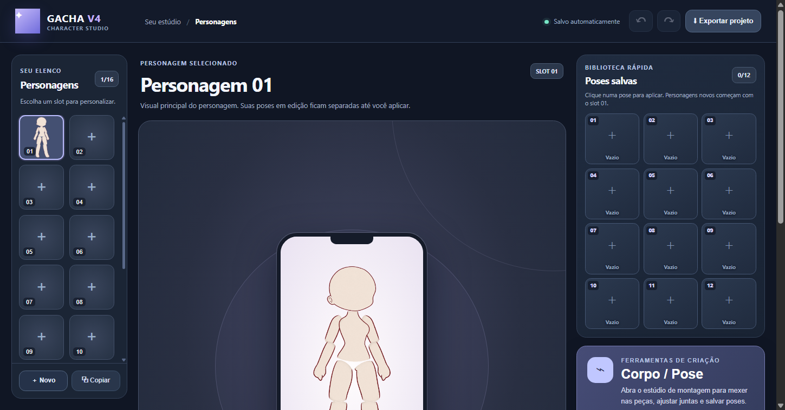
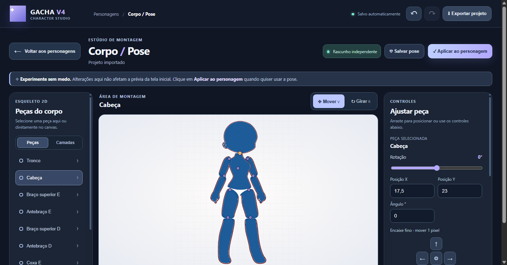
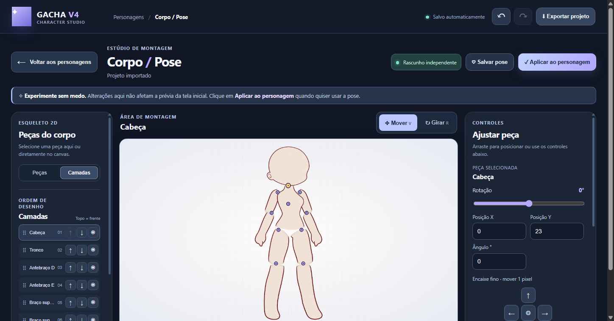
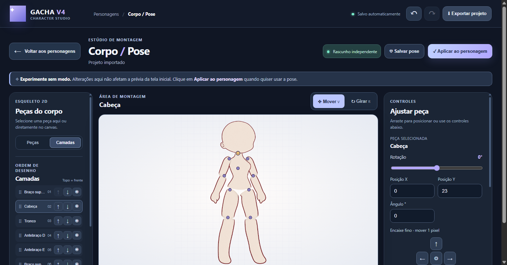
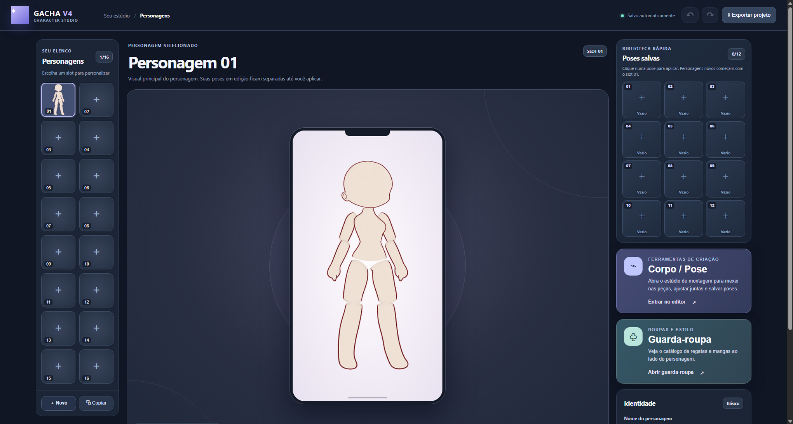
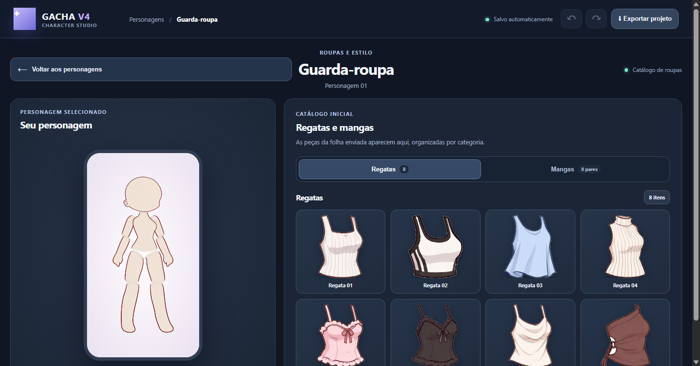

# Gacha V4 — Criador de Corpo e Pose

Editor desktop em português para personagens chibi, com 16 slots, prévia oficial em 9:16 e estúdio independente de montagem por peças.

## Abrir no Windows

Dê duplo clique em `Abrir Gacha V4.bat` na pasta do projeto. O launcher instala as dependências se o Electron ainda não estiver instalado e abre o aplicativo. Mantenha a janela do terminal aberta enquanto testa; ela mostra qualquer mensagem de erro.

## Começar

Requer Node.js 20 ou superior.

```bash
npm ci
npm start
```

## Fluxo de edição

A tela **Personagens** mostra os 16 slots e a pose publicada. **Corpo / Pose** abre o estúdio: ajustes, presets e poses carregadas alteram somente `workingPose`. Use **Aplicar ao personagem** para publicar a pose; voltar à tela inicial preserva o rascunho.

O estúdio inicia em **Mover**. Arraste qualquer peça; `R` alterna para girar e `V` para mover. Setas deslocam 1 px e Shift+seta desloca 10 px. Os campos X, Y e ângulo aceitam edição decimal contínua e registram uma ação de undo. As abas **Peças / Camadas** alternam entre a seleção do rig e a ordem visual; arraste uma linha ou use as setas para mover camadas para frente ou para trás. A ordem e a visibilidade são salvas automaticamente sem remover ajustes.

Poses salvas ficam associadas ao personagem selecionado, têm miniaturas e podem ser carregadas como rascunho, duplicadas, renomeadas, copiadas para outro personagem ou importadas/exportadas como `gacha-pose-v1`. Salvar, renomear, copiar e excluir usam diálogos do próprio app. As poses salvas também ocupam até 12 slots compartilhados na tela inicial; personagens novos recebem a pose do slot 01 quando preenchido.

A página **Guarda-roupa** abre separadamente com o personagem selecionado à esquerda e o catálogo à direita. A primeira folha contém oito regatas e oito pares de mangas, exibidos em categorias. Nesta etapa, as peças ficam no catálogo e não são aplicadas nem encaixadas no personagem. A folha original está em `assets/wardrobe/source-sheet.png`; para regenerar os recortes transparentes e `src/wardrobe-art.js`, rode `python scripts/extract-wardrobe-assets.py` com Pillow instalado.

## Dados e segurança

Projetos usam `format: gacha-body-v1`, versão 1, com 16 slots. Cada personagem contém `pose` (publicada), `workingPose` (rascunho independente), `savedPoses` (até 40 entradas), `layerOrder` e `hiddenParts`. O projeto tem também 12 `poseSlots` compartilhados. Projetos antigos sem rascunho, camadas ou slots compartilhados são normalizados sem alterar a pose publicada; poses já salvas podem preencher a nova grade. A prévia inicial e a exportação PNG usam apenas a pose publicada e respeitam a ordem e a visibilidade das camadas.

O modelo usa os pixels da folha PNG original em `assets/body-original.png`; o recorte e a remoção do fundo verde mantêm a arte e o contorno, e uma máscara separada permite recolorir a pele sem tingir o traço. Para regenerar os recortes e mapas de imagem, instale Pillow e rode `python scripts/extract-body-assets.py`.

O Electron mantém `contextIsolation`, sandbox e `nodeIntegration: false`. JSON importado é validado antes de ser salvo; arquivos de usuário ficam no perfil local. Este projeto é separado do editor de vídeo Gacha V4 e não afirma compatibilidade direta com o formato de timeline V13.

## Verificação

```bash
npm run check
npm test
npm run ui-test
npm run test:e2e
npm run dist -- --dir
npm run test:production
```

Os testes cobrem a geometria de juntas nos cinco presets, PNG de origem e máscaras de cor, normalização e segurança do JSON, navegação entre páginas, rascunho versus pose publicada, edição numérica, CRUD/importação/exportação de poses e projeto, camadas arrastáveis e persistidas, cópia entre personagens, undo/redo, arraste e rotação diretos, snap, zoom, grade, juntas, espelhamento, preview 9:16, PNG transparente, persistência após reabrir a janela e capturas do Electron em 1366×768 e 1920×1080. `test:production` abre o pacote Windows oculto, verifica o IPC de salvamento e confere camadas e cor depois de reiniciar.

Capturas do smoke:














## Limites atuais

O catálogo inicial mostra roupas sem aplicá-las ao rig; encaixe e composição de roupas são etapas futuras. O rig ainda não tem cabelo, rosto detalhado ou importador interativo de assets. Não há adaptador de exportação para o formato de timeline do editor de vídeo.

