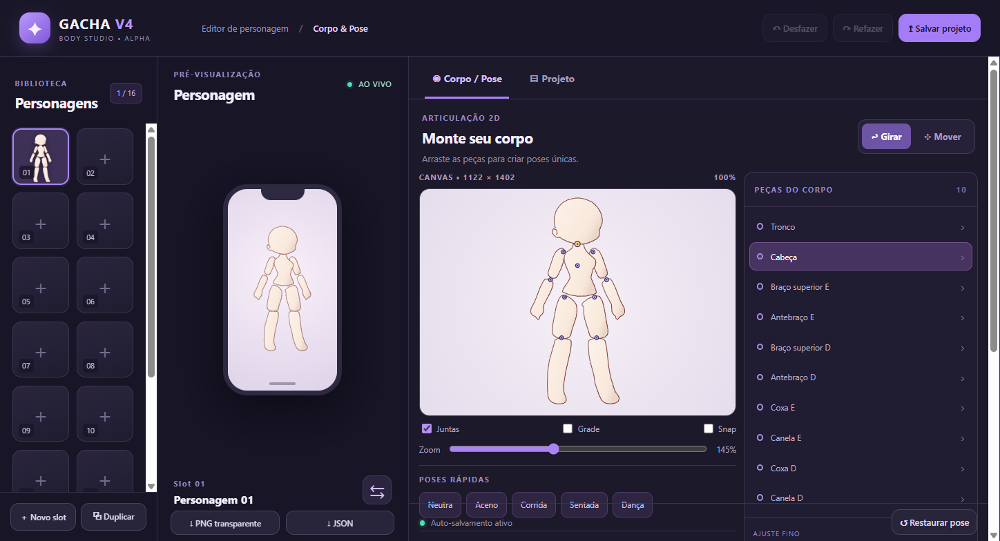
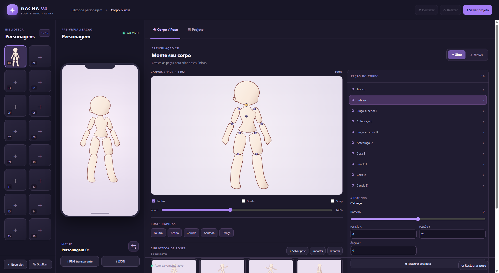

# Gacha V4 — Criador de Corpo & Pose

Editor desktop para personagens chibi com **16 slots (2×8)**, prévia 9:16 e rig articulado por partes.

## Começar
Requer Node.js 20+.

```bash
npm install
npm start
```

Modo navegador (sem Electron): abra `index.html` em um navegador moderno; o estado usa localStorage.

## Recursos do MVP
- 16 slots independentes com criar, copiar, renomear e excluir;
- folha de **10 peças vetorizadas da imagem fornecida**, de modo que as articulações possam ser editadas separadamente;
- edição por arraste (mover / girar), pontos de conexão, propriedades numéricas, simetria e presets de pose;
- prévia vertical 9:16, desfazer/refazer, auto-salvamento local, importação/exportação JSON e PNG transparente;
- Electron com preload isolado, diálogos de arquivo e salvamento atômico no perfil do usuário.
- biblioteca de poses com miniaturas, aplicar, salvar, renomear, duplicar, excluir e importar/exportar;
- ajuste numérico ao digitar, registrado como uma única operação de desfazer.

O projeto editável agora usa `gacha-body-v1` versão 2. Projetos versão 1 são migrados ao abrir, mantendo os 16 slots e adicionando as cinco poses iniciais. A biblioteca exportada usa o formato separado `gacha-pose-library-v1`; nenhum desses formatos representa o esquema de timeline do editor de vídeo.

## Verificação

```bash
npm run check
npm test
npm run test:e2e
```

O teste Electron cobre os slots, arraste e rotação de articulações, undo/redo, biblioteca de poses, JSON, PNG com alpha e recuperação após reinício. As capturas abaixo foram geradas pelo Electron nas larguras lógicas de 1366×768 e 1920×1080:





## Arquitetura
- `src/core.js`: migração de esquema, rig hierárquico, pivôs, biblioteca de poses e renderer SVG puro.
- `src/renderer.js`: interface, controles contínuos, histórico, persistência e operações da biblioteca.
- `electron/main.cjs`, `electron/preload.cjs`: camada desktop.
- `test/electron.e2e.cjs`: interação real do Electron, exportação, persistência e capturas responsivas.
- `AGENTS.md`: tarefas e contratos de continuação para o Codex.

**Importante:** projeto de criação de personagens separado do Gacha Editor V4 de timelines. Exporta seu formato editável `gacha-body-v1`; compatibilidade com `schema_version: 3` e `character_tracks` do editor de vídeo é uma etapa futura descrita no AGENTS.md.

Os contornos SVG foram derivados da imagem-base fornecida pelo autor. Não estão incluídos cabelo, rosto ou roupas por enquanto.
